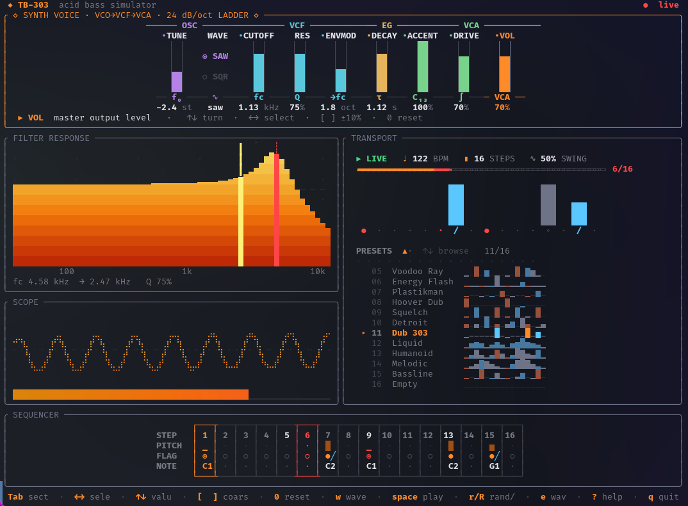

<p align="center">
  
</p>

<h1 align="center">acidflow</h1>

<p align="center">
  A <b>Roland TB-303</b> acid bass simulator that lives in your terminal.<br>
  Diode-ladder filter. 16-step sequencer with p-locks. 16-voice drum machine. Stereo FX. MIDI, JACK, CLAP. No GUI toolkit.
</p>

<p align="center">
  <a href="#install">Install</a> · <a href="#quickstart">Quickstart</a> · <a href="MANUAL.md">Manual</a> · <a href="#how-it-sounds">How it sounds</a> · <a href="#under-the-hood">Internals</a>
</p>

<p align="center">
  
  
  
  
  
</p>

---

The TB-303 ate the back end of dance music in 1987 and never gave it back. **acidflow** is the whole instrument — oscillator, ladder filter, accent envelope, sequencer, slides — modelled from circuit analysis and rendered as a terminal app you actually want to look at.

Type `space` to play. Press `r` to randomize. Drag a knob. Export a WAV. Quit before you finish your next track.

## Features

- **Authentic 303 DSP.** A real diode-ladder filter, not a Moog ladder: the four stages are coupled like the 303's, solved exactly with zero-delay feedback and a tanh on the input node. The filter and drive run at 2× between 59-tap half-band FIRs, and the saturators use antiderivative anti-aliasing, so hard drive stays clean. Exponential V/oct envelope modulation, persistent accent capacitor that stacks across notes, exponential slide RC with τ ≈ 88 ms, ±3 cent VCO drift.
- **9 knobs that mean what their pots mean.** TUNE · WAVE · CUTOFF · RES · ENVMOD · DECAY · ACCENT · DRIVE · VOL. Cutoff: 13 Hz – 5 kHz log. Decay: 0.2–2 s. Envmod: 0–4 octaves. Tuning: ±12 st. Resonance self-oscillates around 90% — same as the real circuit.
- **Sample-accurate 16-step sequencer** (runs on the audio thread) with per-step accent / slide / rest, **probability** (100/75/50/25), **ratchet** (1–4 hits per step), and **per-step parameter locks** on cutoff / resonance / env-mod / accent. Swing 50% straight → 75% hard shuffle. Variable pattern length 4–16. **16 hardcoded presets** inspired by *Acid Tracks*, *Higher State*, *Energy Flash*, *Voodoo Ray*, *Acperience*, Hardfloor, Plastikman, and friends.
- **16-voice drum machine.** Synthesized (not sampled) BD / SD / CH / OH / CL / LT / HT / RS / CB / SH / TB / CG / MT / CY / RD / BG with their own 16-step grid, per-voice gain, per-voice mute, and a master drum-bus send that feeds the same FX chain as the 303 voice.
- **Stereo FX rack.** Pre-filter overdrive, a tempo-synced ping-pong tape delay (1/16, 1/16d, 1/8, 1/8d) with saturation, tone and wow/flutter in the loop, and a Dattorro plate reverb. Drums are panned across the field and a look-ahead limiter holds the master at −1 dBFS.
- **MIDI everywhere.** ALSA on Linux, CoreMIDI on macOS, WinMM on Windows. Forward notes + drum hits (ch 10) + clock, or slave transport / BPM to external clock. `l` on any knob arms **MIDI learn**: move a controller and it's bound (saved to `midi_map.txt`).
- **Live oscilloscope** in 24-bit colour pixels with phosphor afterglow, and a **filter response** chart that plots the ladder's real response and *moves with the envelope* so you can see the squelch.
- **Song mode** — chain saved pattern slots on every wrap — and **jam mode** — turn the computer keyboard into a two-octave tracker piano.
- **Full mouse support.** Click + drag knobs vertically. Scroll to fine-tune. Right-click to reset. Click a step to edit it. Hover onto a panel to focus it. Scroll on the title to nudge BPM.
- **Smart randomizer.** Four character archetypes for knobs, four groove archetypes for patterns, plus `M` for one-at-a-time evolving mutations that "walk" a pattern without obliterating it.
- **9 save slots** (`Shift-1`…`Shift-9` to save, `1`…`9` to load) — each slot stores the full session state (sequence, drums, all knobs, FX) in a plain-text file (`slot_1.txt`…`slot_9.txt`). Drop an AI-generated file here to load it instantly.
- **Shareable pattern export** (`p` to export, `P` to import) — writes the current session to a single compact base64 file (`pattern.txt`) you can paste into a message or forum post. Same full state as a slot, just a different format for sharing.
- **Themes from maya** — acidflow's own "acid" look, your terminal's palette, or any of maya's schemes (gruvbox, tokyonight, dracula, nord, catppuccin…), cycled with `T` and remembered.
- **Cross-platform.** Linux (JACK or ALSA), macOS (CoreAudio), Windows (WASAPI). JACK is used when a server is running (PipeWire's included) and patches straight into a DAW; set `ACIDFLOW_AUDIO=alsa` to force ALSA.
- **CLAP plugin** — the same engine as an instrument in your DAW: notes in (legato = slide, velocity ≥ 100 = accent), 16 automatable parameters, stereo out.
- **Stems.** `e` bounces a 24-bit stereo mix plus the dry synth and drum buses, without stopping playback.
- **Lock-free audio.** UI ↔ audio thread communication is atomic-only. Per-sample 15 ms parameter smoothing kills knob zipper. ~5–6 ms output latency.

## Install

You need a C++26 compiler (recent GCC or Clang), CMake ≥ 3.28, and a sibling checkout of [`maya`](https://github.com/1ay1/maya) — the TUI framework acidflow is built on. maya pulls in its runtime, [jaal](https://github.com/agentty-org/jaal), as a git submodule, so clone it with `--recursive`.

```bash
# Linux: install ALSA dev headers
sudo apt-get install libasound2-dev      # Debian/Ubuntu
sudo dnf install alsa-lib-devel          # Fedora
sudo pacman -S alsa-lib                  # Arch

# Clone with maya as a sibling
git clone --recursive https://github.com/1ay1/maya.git
git clone https://github.com/1ay1/acidflow.git
cd acidflow

# Build
cmake -B build
cmake --build build -j

# Run
./build/acidflow
```

macOS: same recipe — the CoreAudio backend is picked automatically.

Windows: use a Visual Studio generator (MSVC toolchain from VS 2022 or 2026) and pass `--config Release` because the generator is multi-config:

```bat
cmake -B build -G "Visual Studio 18 2026" -A x64
cmake --build build --config Release
.\build\Release\acidflow.exe
```

MSVC doesn't advertise `cxx_std_26` to CMake, so the script sets C++23 there and maya's `maya::app` target adds `/std:c++latest`, `/utf-8` and the conforming-preprocessor flags; acidflow adds `_USE_MATH_DEFINES`. GCC/Clang builds stay on C++26. Run the binary in a terminal that speaks ANSI + UTF-8 (Windows Terminal, WezTerm, Alacritty) — the legacy `cmd.exe` console won't render it correctly.

## Quickstart

You don't need to learn the keys first. Three of them get you everywhere:

```
Space    play / stop
:        search every action by name and run it  (also Ctrl-K)
?        help for the panel you're in; type to search it
```

The first time you start it, a short welcome card shows the rest of the basics. The bottom line always shows the keys for the panel you're in, and hovering anything with the mouse says what it is. Every change can be undone with `u`, and your session (knobs, pattern, drums, theme) is saved when you quit and comes back next time.

The everyday keys:

```
Tab      move between panels (the orange box)
arrows   change what's in the box
r / R    randomize this panel / everything
M        evolve the pattern a little
u / U    undo / redo
W        record a live take
e / E    bounce WAV + stems / export MIDI
n / k    song mode / jam mode
q        quit
```

In the **Knobs** section: `← →` selects, `↑ ↓` adjusts by 5%, `[ ]` by 10%, `0` resets, `w` toggles waveform, `l` MIDI learn, `m` mutes the synth voice.
In the **FX** section: `← →` selects, `↑ ↓` adjusts (TIME steps through the divisions), `0` resets, `l` MIDI learn, `m` mutes the bus.
In the **Sequencer**: `← →` selects step, `↑ ↓` semitone, `< >` octave, `a` accent, `s` slide, `m` rest, `v` cycle probability, `j` cycle ratchet, `F/G/H/J` p-lock cutoff/res/env/accent, `L` clear locks, `x` clear step, `c d e f g a b` set root pitch.
In the **Drums**: `← →` step, `↑ ↓` voice (16 voices, BD → BG), `Space`/`x` toggle hit, `s` mute current voice, `1..9 0` quick-toggle step 1..10 on the selected voice, `[ ]` drum-bus master, `c` clear row, `C` clear kit. You can also click a voice label on the left edge to select it, or right-click a label to clear that row.
In **Transport**: `↑ ↓` browse presets, `[ ]` BPM ±2, `{ }` pattern length, `- =` swing.

The full keyboard map is one `?` away inside the app (and in the **[Manual](MANUAL.md)**). Help and the command palette are built from the same table as the key handler, so what they say is what the keys do.

On a small terminal (under 38 rows, like the default 80×24) acidflow switches to a compact layout: the knobs become a one-line value strip and the scope and filter chart step aside, so everything still fits.

## How it sounds

Load a preset and play with the cutoff. That's it. That's the demo.

The presets are evocations of canonical acid records — not lifted MIDI, but plausible reconstructions of the patterns those tracks are built on. Pair the right preset with the right knob settings and you'll hear *Acid Tracks*-the-feeling, not *Acid Tracks*-the-sample:

| Preset | Try this |
|---|---|
| **Acid Tracks** | classic knobs · 122 BPM · slowly raise cutoff bar by bar |
| **Higher State** | very long decay · cutoff at 30% · let it open over 32 bars |
| **Energy Flash** | drive at 60% · resonance at 80% · 132 BPM |
| **Plastikman** | low cutoff · high res · long decay · half the steps muted |
| **Liquid** | every note slides — you don't have to do anything else |

Hit `R` (capital) repeatedly until something grabs you. The randomizer is intentionally good at finding *playable* patches.

## Under the hood

```
src/dsp.hpp        ── DSP blocks: diode ladder, ADAA tanh, half-band 2× OS, plate, tape delay, limiter
src/engine.cpp     ── The voice, sequencer, drums and FX bus as an acid::Engine instance
src/audio_*.cpp    ── Device drivers (JACK / ALSA / CoreAudio / WASAPI)
src/midi_*.cpp     ── MIDI drivers on a shared parser + clock core (midi_core.hpp)
src/app/           ── The app: state, input, randomizers, persistence, export, view
src/app/program.hpp── The jaal Program around it (maya's runtime)
src/tb303/*.hpp    ── Widgets (knob, sequencer, scope, filter response, ...)
plugin/            ── CLAP instrument
tests/             ── DSP, engine, headless UI and plugin tests
```

The audio thread renders 256-frame stereo blocks and blocks on the OS device. The UI updates `std::atomic` parameters with relaxed ordering; the audio thread snapshots them per block and one-pole smooths at 15 ms. Note triggers go through a single `seq` counter (acquire / release) — no mutexes, no allocations on the audio path. The engine is an object, so offline bounces, tests and the plugin each run their own copy without touching the live one.

The UI is a [jaal](https://github.com/agentty-org/jaal) program: on input or a timer tick it updates the model, and `view()` builds the frame from it without side effects. While nothing moves it ticks at 4 Hz and skips redraws, so an idle acidflow uses no UI CPU.

### Building the extras

```bash
cmake -B build -DACIDFLOW_BUILD_CLAP=ON   # also build acidflow.clap
ctest --test-dir build -LE perf           # run the tests
./build/acid_render out.wav 4             # offline render of a reference line
```

Windows can be cross-compiled from Linux with [llvm-mingw](https://github.com/mstorsjo/llvm-mingw): `-DCMAKE_TOOLCHAIN_FILE=cmake/llvm-mingw.cmake -DLLVM_MINGW=/path/to/llvm-mingw`.

If you want the deep version of all of that, plus every keystroke documented and every knob explained — that's in **[MANUAL.md](MANUAL.md)**.

## AI-generated patterns

acidflow's slot files are plain text — easy for an AI to write. Paste this prompt into Claude, ChatGPT, or any LLM:

```
Generate an acidflow v8 slot file for: [describe the vibe]
Examples: "dark minimal techno, 130 BPM, heavy resonance"
          "funky rolling bassline, 122 BPM, lots of slides"
          "sparse industrial, 138 BPM, low cutoff, dry"

The format is:

# acidflow pattern v8
<pattern_length> <bpm>
[16 step lines: note rest accent slide prob ratchet lockmask lockC lockR lockE lockA]
drums <master_gain>
[16 drum rows (BD SD CH OH CL LT HT RS CB SH TB CG MT CY RD BG), each: 16 space-separated 0/1 values]
knobs <swing> <wave> <tune> <cutoff> <resonance> <env_mod> <decay> <accent> <drive> <volume>
fx <od_amt> <delay_mix> <delay_fb> <delay_div> <rev_mix> <rev_size> <rev_damp>

Field rules:
  note       MIDI note number — 36=C2 (bass root), 48=C3, 60=C4. Typical range 36–60.
  rest       0 or 1 (1 = silence this step)
  accent     0 or 1 (louder + faster filter sweep, stacks on back-to-back hits)
  slide      0 or 1 (legato portamento into this step, τ ≈ 88 ms)
  prob       0–100 (% chance the step fires; 100 = always)
  ratchet    1–4 (sub-triggers per step; 1 = normal, 4 = quad 32nd-note burst)
  lockmask   0–15 bitmask — bit0=cutoff, bit1=res, bit2=env-mod, bit3=accent p-lock active
  lockC/R/E/A  0.0–1.0 (p-lock override values, only applied when the corresponding bit is set)

  swing      0.50 = straight 16ths, 0.62 = classic MPC swing, 0.75 = hard shuffle
  wave       0 = sawtooth, 1 = square
  tune       0.0–1.0 (maps to ±12 semitones; 0.5 = centre/concert pitch)
  cutoff     0.0–1.0 (13 Hz at 0, ~5 kHz at 1 — keep 0.2–0.6 for most acid patches)
  resonance  0.0–1.0 (self-oscillates above ~0.9; 0.6–0.85 is the classic squelch zone)
  env_mod    0.0–1.0 (envelope modulation depth; 0.5–0.8 for screaming sweeps)
  decay      0.0–1.0 (filter/amp decay; 0.0 ≈ 0.2 s, 1.0 ≈ 2 s)
  accent     0.0–1.0 (accent intensity)
  drive      0.0–1.0 (pre-filter saturation; 0 = clean, 0.5+ = gritty)
  volume     0.0–1.0
  od_amt     0.0–1.0 (master-bus overdrive; 0 = bypass)
  delay_mix  0.0–1.0 (0 = dry)
  delay_fb   0.0–1.0 (delay feedback; 0.3–0.5 typical)
  delay_div  0=1/16, 1=1/16 dotted, 2=1/8, 3=1/8 dotted
  rev_mix    0.0–1.0 (0 = dry)
  rev_size   0.0–1.0 (reverb decay time)
  rev_damp   0.0–1.0 (high-frequency damping; 0 = bright, 1 = dark)
  master_gain  0.0–1.5 for the drum bus
```

Save the output as `slot_1.txt` (or `slot_2.txt` … `slot_9.txt`) in:

- **Linux / macOS:** `~/.config/acidflow/`
- **Windows:** `%APPDATA%\acidflow\`

Then press `1`–`9` in acidflow to load it. Use `Shift-1`…`Shift-9` to overwrite a slot with your current session.

## Built on

- **[maya](https://github.com/1ay1/maya)** — the C++26 TUI framework that does the rendering, layout and mouse hit-testing.
- **[jaal](https://github.com/agentty-org/jaal)** — maya's runtime: the event loop, timers and input routing acidflow runs on.

## Status

acidflow is a personal project, but it's complete enough to make actual music with. Bug reports and pattern submissions welcome.

## License

MIT, see [LICENSE](LICENSE). Everything acidflow builds with is MIT too: maya, jaal, and the CLAP SDK (fetched only for the plugin build). Nothing GPL is linked.
